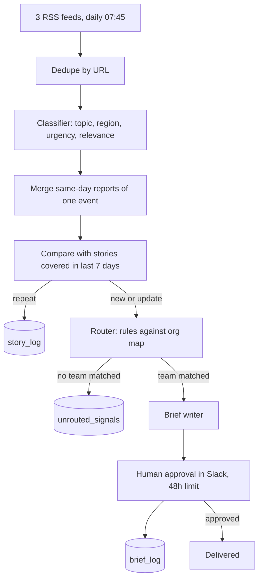

# AIA Signal Pipeline

A human-supervised agent pipeline that turns daily trade and shipping news into short, team-specific briefs, routed by an organisation map and approved by a person before anything is delivered.

Built in n8n with Claude models. Status: working prototype in shadow mode (every brief goes to a review channel, nothing reaches a real team yet). The org map is a placeholder for a fictional freight brokerage.

## The problem

Most companies already have news. What they lack is the step between news and action: deciding which team a development affects, what it could change for them, and whether they have already been told. Generic news digests send everything to everyone, so people stop reading them.

## How it works

| Step | Type | What it does |
|---|---|---|
| Classifier | LLM (Claude Haiku) | Tags each article with topics and regions from a fixed list, an urgency from 1 to 3, and a relevance flag. Regions describe affected trade lanes and corridors (for example `middle_east_gulf`, `red_sea_suez`), not where the story was published. |
| Same-day grouping | LLM + code | Merges several reports of one event so a team gets one brief, not three. Code picks the most urgent report as the lead. |
| Story memory | LLM + rules | Compares each event with stories already covered in the past 7 days. Repeats are logged and held back. Updates are sent as "Update" plus a one-line "Last week" recap. An article already logged this week is always a repeat, by rule. |
| Router | Deterministic code | Matches topic, region and minimum urgency against each team's row in the org map, and writes a plain-text routing reason. No LLM decides who receives what. |
| Brief writer | LLM (Claude Sonnet) | 80 to 120 words: what happened, why it reaches this team, what it could change (marked as assessment, not fact), one action to check. Facts from the source text only. |
| Approval | Human | Each draft is posted to Slack with Approve and Reject. Every decision, including expiry after 48 hours, is logged. |

## Design principles

1. **Routing is explainable.** Every brief carries the exact rule that sent it, for example: `Matched topic shipping_disruption and region middle_east_gulf; urgency 3 meets threshold 2 (2 similar reports merged into this brief)`. A reader can check why they received it.
2. **Models judge, code decides.** LLMs classify, group and write. Routing, lead selection and the "already seen this week" rule are code, so they behave the same way every time.
3. **Fail open, never silent.** If grouping or the story comparison fails, events go through individually. One malformed model reply skips one article instead of stopping the run. Pipeline failures post an alert to Slack.
4. **Assessment is labelled.** Briefs separate what the source says from what it could mean.
5. **A person approves everything** until the approval log shows the drafts can be trusted.

## What testing found

Results from test runs on 12 October 2026 against live feeds. These are engineering tests, not production metrics.

| Test | Result | Change made |
|---|---|---|
| First end-to-end run, 15 articles | 4 relevant, 3 briefs, 1 correctly held below threshold. Briefs stayed within the source. | Slack formatting and duplicate source link fixed. |
| Region tags | Almost everything was tagged "global", which made the region filter meaningless. | Regions redefined as affected trade lanes and shipping corridors. "Global" only for genuinely worldwide effects. |
| Same story from several outlets | Three reports on the same Gulf attacks would have produced three briefs. | Same-day grouping added. 11 relevant articles became 9 events. |
| Group lead choice | The model picked a minor article (urgency 1) to represent a group whose strongest report was urgency 3. | Lead is now chosen in code as the most urgent report. |
| 7-day story memory, same 32 articles rerun | 6 of 7 events correctly held as repeats. 1 false "update": the stored summary had dropped a detail, which the model then read as news. | Rule added: an article already logged this week is always a repeat. |
| Robustness | One malformed model reply in 32 articles stopped a whole run. | Classifier retries three times, then skips only that article. |
| Approval loop | 4 decisions (2 approved, 2 rejected) logged correctly; approved briefs reposted with source. | None needed. |

## Known limitations

- **Sources:** three maritime trade-press feeds. Trade-policy, customs and EU-India sources are needed before the commercial and finance rows of the org map receive anything meaningful.
- **Org map:** placeholder exposure notes. The "why it reaches you" line is only as good as the mapping done with a real client.
- **Urgency:** the same article can receive different urgency scores on different runs. The approval log is the place to measure how often this matters.
- **Update briefs** are implemented but not yet observed on a genuine follow-up story.
- **Approval buttons** open a browser tab (standard n8n Slack behaviour). A custom Slack app with interactivity would keep approval inside Slack.

## Repository contents

| File | Purpose |
|---|---|
| `workflows/signal-pipeline.json` | Main daily pipeline |
| `workflows/brief-approval.json` | Approval sub-workflow, called once per brief |
| `workflows/error-alerts.json` | Posts failures to Slack |
| `data/org_map.example.csv` | Example org map with placeholder teams |

Credentials, IDs and channel names are removed from the exported workflows.

## Running it

1. Import the three workflow files into n8n (version with Data Tables support).
2. Create the data tables `org_map`, `brief_log`, `story_log` and `unrouted_signals`, and load `org_map.example.csv`.
3. Add an Anthropic API key and a Slack credential, and point the Slack nodes at your review channel.
4. Reconnect each data table node, the sub-workflow call and the error workflow setting to your own IDs.
5. Run once manually and check the review channel before publishing the schedule.

## Stack

n8n (workflows, data tables, Slack approval) · Claude Haiku and Claude Sonnet via the n8n Anthropic nodes · Slack · RSS
